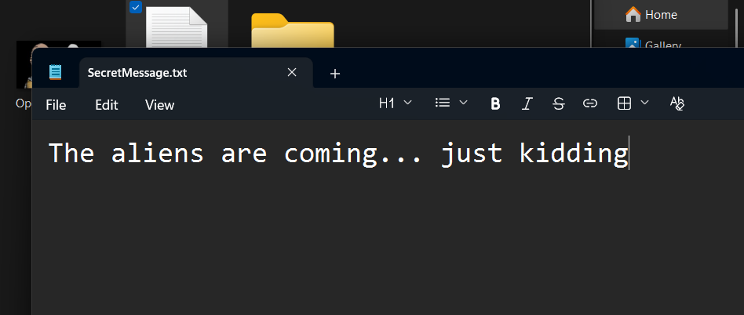
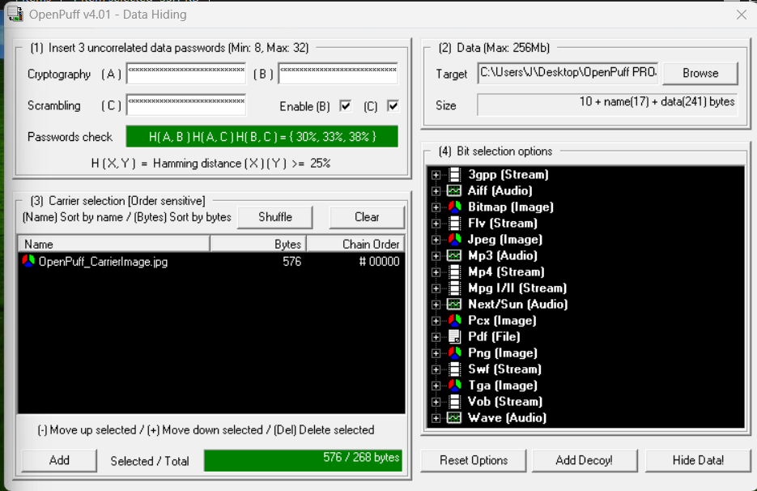
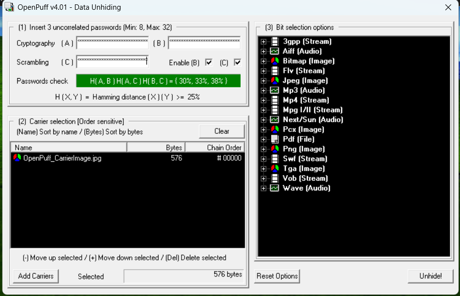
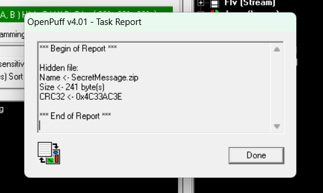
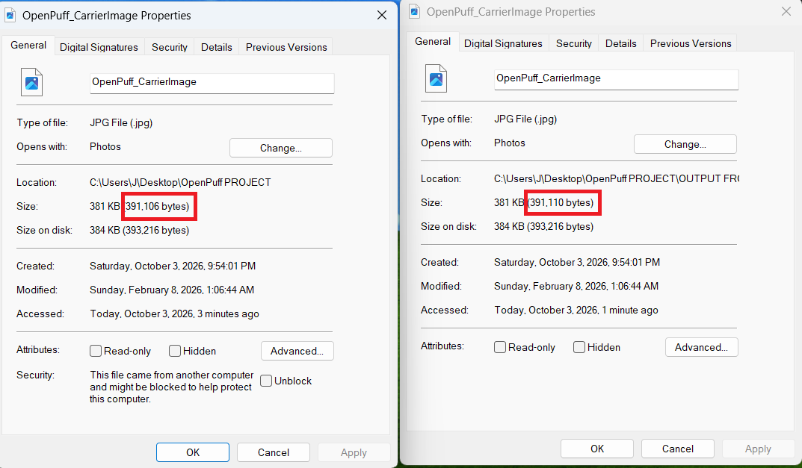

# OpenPuff Steganography Lab

By **NGGAPLZ**. A Windows lab hiding a harmless text-message ZIP in a JPEG carrier
and recovering it with OpenPuff. The project documents the workflow, file-size
observations and recovery evidence. It is a lab report, not a custom steganography engine.

## Workflow and evidence

The original message was "The aliens are coming... just kidding".
The text file was compressed into a ZIP, selected in OpenPuff's Hide dialog,
and embedded into the chosen carrier using three passwords.

The modified carrier was then selected in Unhide with the same passwords.
OpenPuff's recovery report identified the hidden ZIP as 241 bytes.

## Observations

| Artifact | Original supplied size |
|---|---:|
| Carrier before embedding | 391,106 bytes |
| Carrier after embedding | 391,110 bytes |
| Hidden ZIP | 241 bytes |
| Carrier size change | +4 bytes |

The original report says no visible difference was noticed. A four-byte size
increase does not mean the payload was only four bytes, nor does it establish
that the modification is undetectable. File size and visual appearance alone
cannot determine whether a carrier contains hidden data.

During preparation, the supplied input ZIP and recovered ZIP were compared and
found byte-identical. Their SHA-256 digests and sizes are recorded in
[observations.json](observations.json). This independently checks the supplied
files' equality; OpenPuff extraction itself was not rerun.

## Security interpretation

Steganography conceals the presence of a message; encryption protects readability.
The two can be combined. Hiding code in a picture does not itself cause that code
to execute when the picture is opened. A separate extraction/execution mechanism
would be needed. The [steganography technique reference](https://attack.mitre.org/techniques/T1027/003/)
describes adversarial uses; this lab used only a harmless message.

Resizing or recompression may damage an embedded payload. That experiment was
**not performed** in the submitted lab, so this project makes no measured claim
about surviving social-media processing. The [HiDDeN paper](https://arxiv.org/abs/1807.09937)
studies learned data hiding under distortions; it does not establish robustness
for this OpenPuff carrier or equate steganography with prompt injection.

## Repeating the exercise

Use your own image that you have permission to redistribute, the provided sample
message, and new lab-only passwords. Keep the original and modified carrier
separate, recover the payload, and compare its bytes or digest with the input.
Keep passwords out of the repository. The original password file and carrier
images are intentionally omitted; the carrier's redistribution provenance was
not established. The screenshots retain the application evidence rather than
redistributing the source artwork as a standalone asset.

This package does not include OpenPuff binaries, the original password-protected
carrier, or a claim that the experiment has been reproduced on another system.
No license has been selected.
